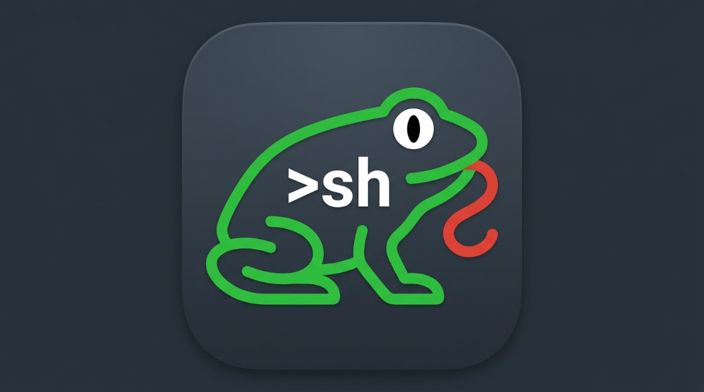
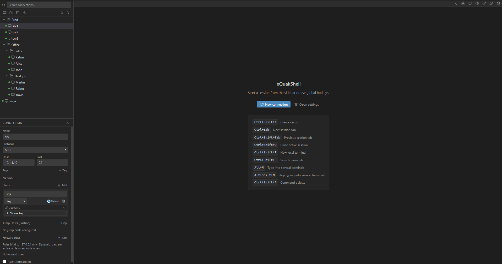
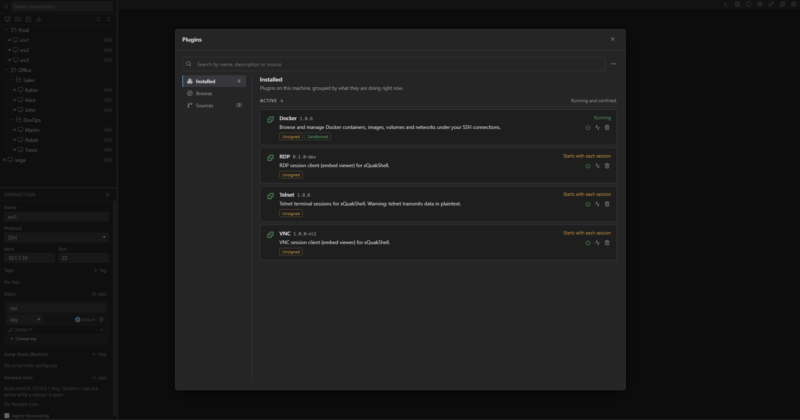
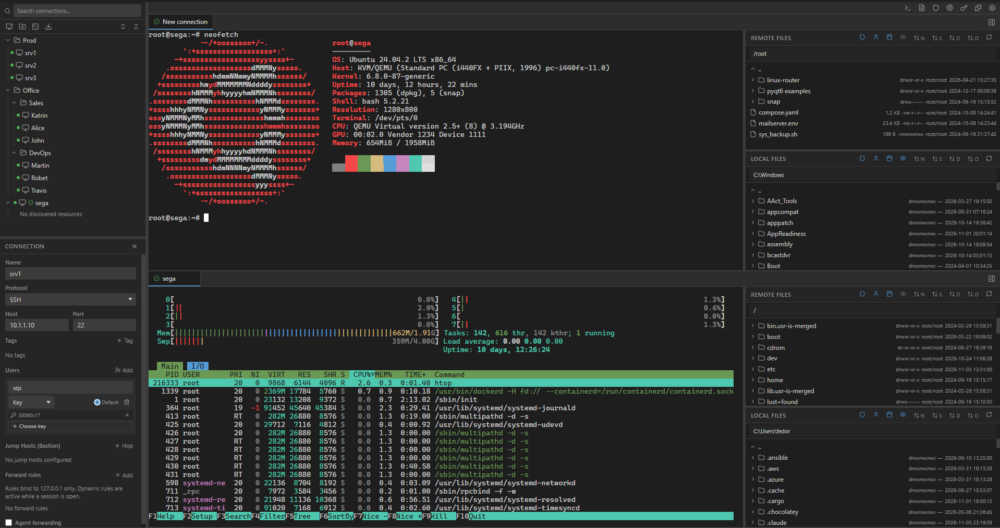
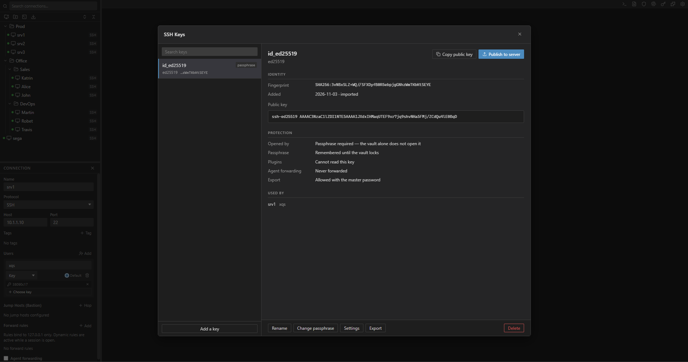

# xQuakShell

<p align="center">
  
</p>

<p align="center">
  <strong>Portable, secure remote-access platform, extensible via out-of-process plugins.</strong>
</p>

<p align="center">
  <a href="./LICENSE"></a>
  
  
  <!--  -->
  <a href="https://t.me/xQuakShell"></a>
</p>

<p align="center">
  <a href="#why-xquakshell">Why</a> •
  <a href="#features">Features</a> •
  <a href="#screenshots">Screenshots</a> •
  <a href="#quick-start">Quick Start</a> •
  <a href="#building">Building</a> •
  <a href="#documentation">Documentation</a> •
  <a href="#community">Community</a>
</p>

---

## Why xQuakShell

Most SSH clients force a choice: either you get a polished terminal with no real extensibility, or you get "plugins" that are just DLLs running with full access to your process, your vault, and your filesystem.

xQuakShell doesn't make you choose:

- **Portable by design.** No installer, no registry, no system-wide state. The vault, audit log, and every installed plugin live next to the executable file. Copy the folder to a USB stick and your whole setup — connections, keys, plugins — moves with it.
- **A plugin system that tells you what it grants.** Every plugin is a separate OS process, resource-limited (Job Objects on Windows, rlimits on Linux/macOS), talking to the core only through a capability-gated JSON-RPC channel: a plugin declares in its manifest exactly which files, hosts, and vault fields it needs, calls outside that are refused and audit-logged, and the install screen shows you the list before you agree to it. On Windows and Linux the operating system confines the process itself as well — an AppContainer or a Landlock ruleset that leaves it reaching nothing but its own directories — and each plugin's settings row says which boundary it is actually behind. macOS has no such confinement, so installing a plugin there is a decision about its author. The [Security Model](./docs/security-model.md) states the boundary and its gaps precisely.
- **Protocols are contributions, not core features.** SSH ships in the core. Everything else — VNC, Telnet, RDP, Discovery plugins, whatever you need next — is a `SessionConnector` implementation registered through a plugin manifest. You're not waiting on a roadmap to add a protocol; you can build it.
- **Nothing silently trusts the network.** Strict host-key verification with no auto-accept, an encrypted vault (age + scrypt) instead of plaintext config, and a local audit log that records actions without ever recording secrets.
- **Sync that does not trust the server either.** Your devices and your team share a vault through `xqsyncd`, a server you run yourself. Everything is encrypted and signed on the device: the server cannot read a host name or a password, alter a record, roll a vault back, or add a device without every device noticing. Credentials are never shared within a team — each member links their own.

If you manage servers from a laptop that leaves the office, or you need a remote-access tool you can extend without giving every plugin the keys to the whole app, this is the tradeoff xQuakShell is built around.

---

## Features

- Encrypted vault (`vault.age`) for connections, keys, credentials, known hosts — protected by a master password (age + scrypt), with a recovery key shown once at creation if you ever forget it. Nobody else can recover the vault, by design.
- SSH key manager: generate (Ed25519, RSA, ECDSA), import, export and rename keys, publish a public key to a server's `authorized_keys`, and choose per key whether the vault alone opens it or it keeps a passphrase of its own, and how long that passphrase is remembered.
- SSH terminal + SFTP file manager: upload, download, rename, delete, create files and folders, change permissions (recursively, files or folders only), sort by name, size, date or owner, show hidden files, and drag files in straight from your system's file manager. Transfers run in parallel with a configurable limit, speed cap and a rule for files that already exist.
- Edit a remote file in the editor of your choice: it is downloaded, opened in the editor set in **Settings → Files**, and uploaded back when you save. Local files open for editing from the same menu.
- Scripts & Commands: preset and saved commands — disk space, listening ports, service status and your own — run in the active terminal from the top bar or by a hotkey of their own.
- Connection tree with nested folders, drag-and-drop, favorites, tags, search, and a TCP reachability ping for every host; import from `~/.ssh/config` (with `ProxyJump` as a jump chain) or from PuTTY sessions and `.ppk` keys.
- Multi-tab sessions with independent lifecycle, and tiles: drag a tab to split the workspace and see several sessions at once.
- Sync between your devices through a self-hosted server (`xqsyncd`, also as a container image), end-to-end encrypted, with field-by-field merging of offline edits, a trash, and Shred now.
- Team vaults: share connections with other accounts as admin, editor or viewer, after comparing fingerprints; nobody's password or key is shared.
- Search across every terminal's scrollback (`Ctrl+Shift+F`), with match case, whole word and regular expressions.
- Type into several terminals at once (`Alt+M`), with the chosen terminals outlined so it is always clear what a keystroke reaches.
- Automatic reconnect after a dropped connection, keeping the tab, its tile and the terminal output.
- Agent forwarding with keys from the vault — opt-in per key and per connection, every signature confirmed, logins only.
- Duplicate a saved connection in one click.
- A local terminal on your own machine as a third kind of tab — `Ctrl+Shift+T` or the button beside "New connection", with the shell picked from the ones this computer actually has. Not reachable by plugins, and your keystrokes in it are not recorded.
- Translated interface (English and Russian), switchable at runtime from **Settings → Appearance**, alongside the terminal font and colors and an interface scale that reflows instead of zooming. Add a language, or correct one phrase, by dropping a JSON file into `data/locales`; a plugin is told which language the interface is in and can ship its own catalog.
- Jump hosts and strict host key verification (no silent auto-accept); IPv4, IPv6 and host names alike.
- Trusted Peers: the same trust-on-first-use check for protocols that are not SSH, with every recorded identity listed and revocable.
- Local/remote/dynamic port forwarding.
- Out-of-process plugin system: capability-gated, versioned IPC handshake, resource-limited, extensible to new connection protocols — installable straight from GitHub or GitLab, or as signed `.xqsp` bundles, with your own trusted publisher keys. Plugin commands are one `Ctrl+Shift+P` away in the command palette.
- Local audit log: searchable command history you can copy from or re-run, a separate log of what the application itself did, retention by age or count, and password-like input masked. Off until you turn it on.
- Session lockout on idle or minimize, and rate-limited master password attempts.
- Update check against GitHub releases, on startup or on demand.
- Portable Windows build with bundled WebView2 runtime (`make portable`) — works on clean/offline machines.

## Official plugins

Protocols beyond SSH are provided by out-of-process plugins installed
from GitHub or GitLab through the in-app plugin manager. The officially maintained ones:

| Plugin | Protocol | Links |
|--------|----------|-------|
| **VNC** — remote desktop in an embedded noVNC viewer (fit-to-window, quality/bandwidth controls, auto-reconnect) | `vnc` | [Releases](https://github.com/teoritty/xqs-plugin-vnc/releases) · [Source](https://github.com/teoritty/xqs-plugin-vnc) |
| **Telnet** — plaintext terminal sessions, optional auto-login | `telnet` | [Releases](https://github.com/teoritty/xqs-plugin-telnet/releases) · [Source](https://github.com/teoritty/xqs-plugin-telnet) |
| **Docker discovery** — Docker management inside xQuakShell | `discovery` | [Releases](https://github.com/teoritty/xqs-plugin-docker-discovery/releases) · [Source](https://github.com/teoritty/xqs-plugin-docker-discovery) |

Want to build your own? Start with the [Plugin API Reference](./docs/plugin-api.md) and [Plugin Manifest schema](./docs/plugin-manifest.md).

## Screenshots

### Main workspace



### Plugins



### Tiles



### Key Management



---

## Download

Releases are published on GitHub: <https://github.com/teoritty/xQuakShell/releases>. Every release
publishes portable archives — unpack and run, no installer, no system-wide state. `SHA256SUMS`
covers every archive: `sha256sum -c SHA256SUMS --ignore-missing`.

| Platform | Archive | Pick this one when |
|----------|---------|--------------------|
| Windows | `…-windows-amd64-portable.zip` | The machine already has the WebView2 runtime (Windows 11, and most Windows 10 installs) |
| Windows | `…-windows-amd64-portable-webview2.zip` | Clean or offline machines — WebView2 Fixed Runtime is bundled |
| Linux | `…-linux-amd64-webkit4.1.tar.gz` | Ubuntu 22.04+, Debian 12+, Fedora 40+, Arch — start here |
| Linux | `…-linux-amd64-webkit4.0.tar.gz` | Older systems still carrying the webkit2gtk-4.0 runtime |

The sync server ships alongside, for those who run one: `xqsyncd-<version>-windows-amd64.zip`,
`xqsyncd-<version>-linux-amd64.tar.gz` and `xqsyncd-<version>-linux-arm64.tar.gz`, and the container
image `ghcr.io/teoritty/xqsyncd` for `linux/amd64` and `linux/arm64`. Installing it as a service, in
Docker, and backing it up are covered in the [Sync Server guide](./docs/sync-server.md).

There is also a rolling [`nightly`](https://github.com/teoritty/xQuakShell/releases/tag/nightly) on GitHub
pre-release, rebuilt from `main` whenever it moves and carrying the same four archives. It is
replaced in place, so its links always point at the newest build and never at the one you tested
yesterday. Use a tagged release for anything you rely on.

Each archive unpacks into a folder of its own and carries a README. Windows will show
"Windows protected your PC" on first run — the binaries are not code-signed, so SmartScreen has no
publisher to check; **More info → Run anyway**, or verify the archive against `SHA256SUMS` first.

WebKitGTK is part of the Linux system and cannot be bundled the way WebView2 is on Windows, and its
4.0 and 4.1 ABIs are not interchangeable — hence two archives. Both are built against glibc 2.35
and require it or newer. If the wrong one is unpacked, the launcher says so and names the package
to install. The Linux archive carries a launcher, a desktop entry and its own README; run
`./install-desktop-entry.sh` to add it to the application menu.

---

## Quick Start

### Prerequisites

- Go 1.26.10+ — the version `go.mod` requires and every workflow builds with; `go` fetches it by
  itself when yours is older
- Node.js 20.19+ or 22.12+ (Vite 8 refuses to run on anything older; CI builds on 20)
- Wails CLI v2.17.0 — pinned, not `@latest`: it must match the library version in `go.mod`, and
  `make` will tell you the same if it is missing.
  ```bash
  go install github.com/wailsapp/wails/v2/cmd/wails@v2.17.0
  ```

### Production build

```bash
make install
make build
```

Output: `build/bin/xQuakShell.exe` on Windows, `build/bin/xQuakShell` elsewhere.

### Portable build (Windows)

```bash
make portable
```

Bundles WebView2 Fixed Runtime into `build/bin/WebView2/`.

### Linux build

```bash
make deps-linux              # prints the system packages to install
make build WEBKIT=4.1        # omit WEBKIT to link webkit2gtk-4.0
```

The release archives are assembled by [`.github/workflows/release.yml`](.github/workflows/release.yml), which adds the launcher,
desktop entry and icon from `packaging/linux/`.

---

## Building

| Target | Command | Description |
|--------|---------|-------------|
| Build app | `make build` | Full Wails build |
| Portable | `make portable` | Build + WebView2 Fixed Runtime |
| Install deps | `make install` | Frontend dependencies |
| Clean | `make clean` | Remove build artifacts |

### Build modes

- `make build`: compact output, requires WebView2 runtime on target machine.
- `make portable`: larger output, works on clean/offline Windows machines.

---

## Security

The plugin boundary is enforced at several layers, not just "trust the manifest":

| Layer | What it enforces |
|-------|-------------------|
| **Process separation** | Each plugin runs as its own OS process; per-plugin or per-session isolation modes; killed on host shutdown or crash, restarted with backoff. |
| **Capability gate** | Every plugin→core call (`fs.*`, `net.dial`, `vault.getSecret`, …) is checked against the plugin's declared manifest capabilities; unmatched calls are denied and logged, never silently allowed. |
| **API version handshake** | The core, not the plugin, is the authority on compatibility — a plugin's echoed version is never trusted for enforcement. |
| **Resource limits** | Memory/handle caps via Job Objects (Windows) or rlimits (Linux/macOS/BSD); oversized IPC frames and file reads/writes are rejected. |
| **Ownership checks (IDOR)** | Vault and session access is scoped to the plugin that owns the active session — a plugin can't reach another plugin's or another session's data. |
| **Secrets** | Vault contents are encrypted at rest (age + scrypt); secret field values never round-trip to plugin logs, audit logs, or the frontend after save. |

**OS-level isolation, per platform.** Every row above governs what a plugin asks the core to do. The
operating system now governs what a plugin does by itself — on two of the three platforms:

| Platform | What a plugin process can reach |
|---|---|
| Windows | Its own installed files and its own data directory. No sockets at all, not even loopback. |
| Linux (kernel 5.13+) | The same, plus the system libraries it needs to start. Its network is unrestricted below kernel 6.7, and TCP-only above it — Landlock has no rule for UDP. |
| macOS | Everything your account can, including `~/.ssh`. There is no sandbox here and none is planned. |

Each plugin's settings row says which of these it is actually running behind. Where a platform can
confine a plugin and the attempt fails, the plugin does not start, rather than starting unconfined
and reporting success. Installing a plugin is still a decision about trusting its author.
[Security Model → Trust model](./docs/security-model.md#trust-model-and-what-it-does-not-cover) is
the precise statement of the boundary and its gaps.

**Sync and teams.** The sync server is treated as hostile. Records are encrypted and signed on the
device, so the server sees accounts, devices, record counts, padded sizes and commit times — never a
field of a record, a password or a key. It cannot forge or silently roll back a vault, and showing
two devices different histories is detected the moment they meet. A change from another device that would weaken this one — turning off plugin
signature checks, loosening the lockout, replacing or deleting a known host key or a key — waits for
this device's master password. In a team, a member who repoints a shared connection suspends every
other member's credential link to it until they confirm, so nobody's password follows a connection
to a host they did not choose. [ADR-023](./docs/adr/023-state-sync.md) has the design.

**Agent forwarding** is off for every key until you allow it, and then every signature is confirmed
with the server, the key and the destination named. Only logins are signed, and jump hosts and plugin
connections never get the agent.

Full write-up in [Security Model](./docs/security-model.md) and the [ADRs](./docs/adr/).

If you find a vulnerability, please follow the process in [SECURITY.md](./SECURITY.md) rather than opening a public issue.

---

## Documentation

- [Usage Guide](./USAGE.md)
- [Architecture & extensibility](./docs/architecture.md)
- [Plugin API Reference](./docs/plugin-api.md)
- [Plugin Manifest schema](./docs/plugin-manifest.md)
- [Security Model](./docs/security-model.md)
- [Sync Server (xqsyncd)](./docs/sync-server.md) — installing and running the self-hosted sync server
- [Environment Workarounds](./docs/environment-workarounds.md) — driver and system-library failures that look like application bugs
- [Contributing](./CONTRIBUTING.md)
- [Security Policy](./SECURITY.md)

---

## Community

Questions, feedback, or just want to follow development? Join the Telegram channel: **[t.me/xQuakShell](https://t.me/xQuakShell)**

---

## License

See [LICENSE](./LICENSE) (GPLv3).